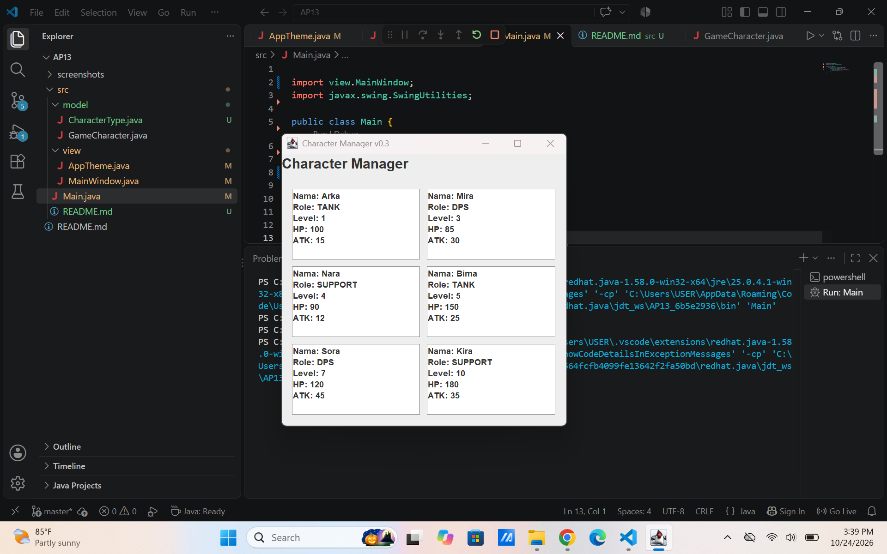
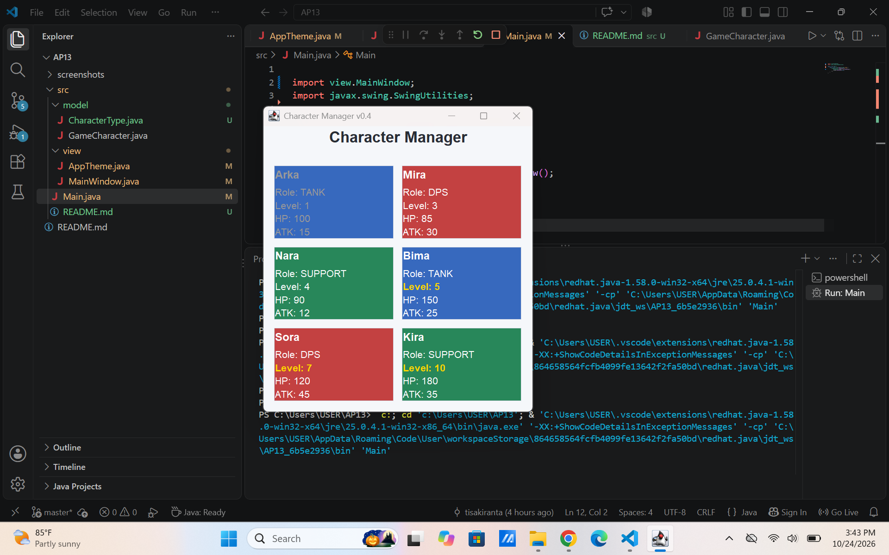

## TP10 — Implementasi Tema

### Screenshot Sebelum (v0.3)

### Screenshot Sesudah (v0.4)

!Tampilan aplikasi sesudah implementasi tema

Alasan Penggunaan AppTheme

Warna disimpan di AppTheme karena warna merupakan bagian dari tampilan aplikasi (View), bukan data karakter (Model). Pemisahan ini membuat pengaturan warna lebih terpusat dan konsisten. Jika warna perlu diubah, saya cukup memperbarui AppTheme tanpa mengubah class GameCharacter. Dengan cara ini, tanggung jawab Model dan View dalam pola MVC tetap terpisah.

Dua Properti Tambahan
Tooltip HP dan ATK: memudahkan pengguna melihat detail karakter tanpa menambah banyak teks pada kartu.
Karakter level 1 dinonaktifkan: membedakan karakter level awal dari karakter lain pada antarmuka.
Analisis MVC dan Properti Swing

Dokumen analisis Bagian D: [Tempelkan link Google Docs di sini]