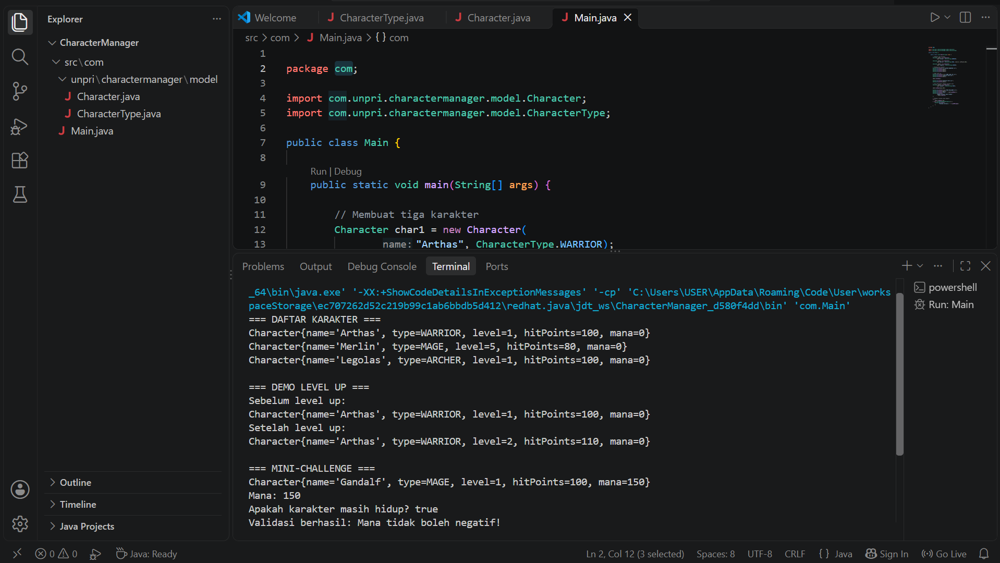

# Character Manager — TP3 (Java Visual SIH-6406)
## Deskripsi

Character Manager adalah program berbasis Java yang digunakan untuk mengelola karakter game menggunakan konsep Pemrograman Berorientasi Objek (OOP). Program ini memiliki fitur pembuatan karakter, pengaturan level, hit points (HP), tipe karakter menggunakan enum, serta peningkatan level (level up). Selain itu, program dilengkapi dengan atribut mana, validasi nilai mana agar tidak negatif, dan method isAlive() untuk memeriksa apakah karakter masih hidup berdasarkan nilai HP.

## Screenshot Output Terminal

Berikut adalah hasil eksekusi program yang menampilkan tiga karakter, demonstrasi level up, atribut mana, hasil pemeriksaan isAlive(), dan validasi mana negatif.

## Screenshot Output Terminal



## Struktur Folder Project

```
CharacterManager/
├── src/
│   └── com/
│       ├── Main.java
│       └── unpri/
│           └── charactermanager/
│               └── model/
│                   ├── Character.java
│                   └── CharacterType.java
├── screenshots/
│   └── output-terminal.png
└── README.md
```

## Identitas Mahasiswa
**Nama lengkap**             : Tisa Kiranta Br Tarigan
**NIM**                      : 253303621277
**Link Google Docs Bagian D**: https://docs.google.com/document/d/1H1kSqVmylhUJ7km8Ja1zqyYtVCurgs787BVLEGl63nM/edit?usp=sharing

## Fitur Program
-Empat konstanta enum untuk tipe karakter.
-Dua constructor untuk membuat objek karakter.
-Getter dan setter untuk atribut karakter.
-Method levelUp() untuk meningkatkan level karakter.
-Atribut mana bertipe int.
-Validasi mana negatif menggunakan IllegalArgumentException.
-Method isAlive() untuk memeriksa apakah karakter masih hidup.
-Method toString() untuk menampilkan informasi karakter, termasuk mana.
