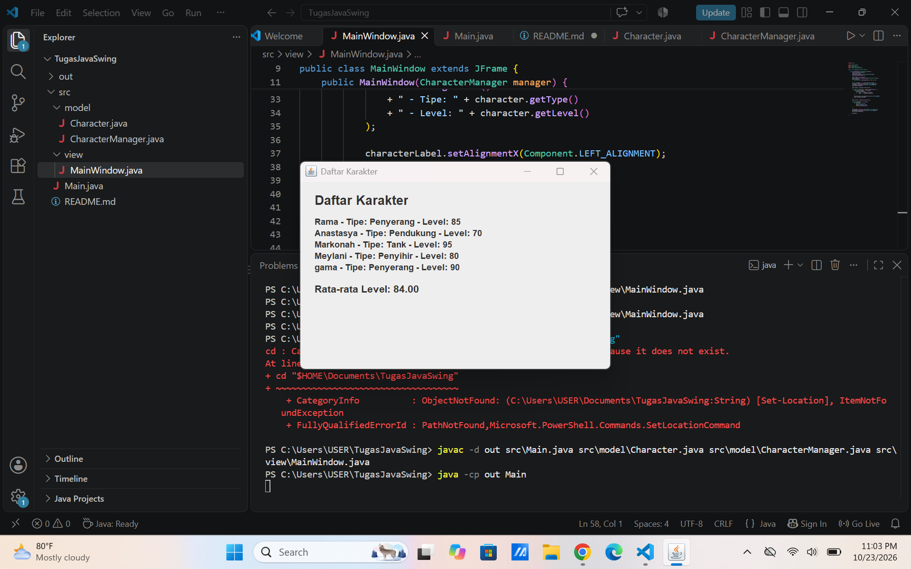
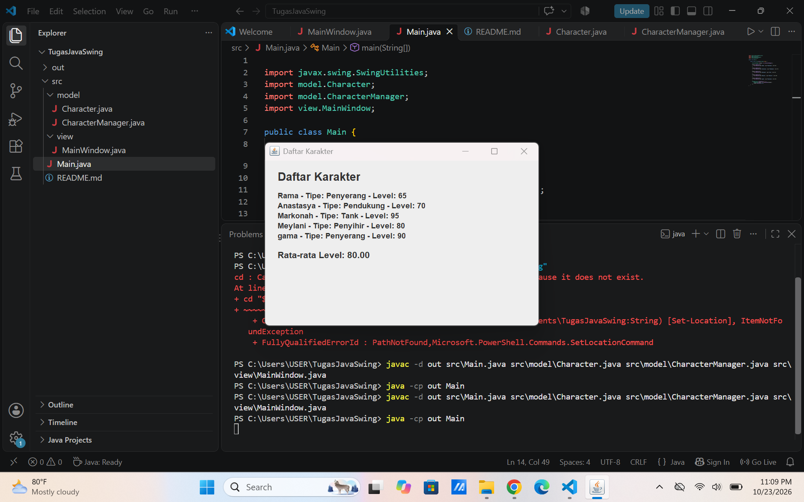

# Character Manager — TP3 (Java Visual SIH-6406)
## Deskripsi

Character Manager adalah program berbasis Java yang digunakan untuk mengelola karakter game menggunakan konsep Pemrograman Berorientasi Objek (OOP). Program ini memiliki fitur pembuatan karakter, pengaturan level, hit points (HP), tipe karakter menggunakan enum, serta peningkatan level (level up). Selain itu, program dilengkapi dengan atribut mana, validasi nilai mana agar tidak negatif, dan method isAlive() untuk memeriksa apakah karakter masih hidup berdasarkan nilai HP.

## Screenshot Output Terminal


## Struktur Folder Project

```
CharacterManager/
├── src/
│   └── com/
│       ├── Main.java
│       └── unpri/
│           └── charactermanager/
│               └── model/
│                   ├── Character.java
│                   └── CharacterType.java
├── screenshots/
│   └── output-terminal.png
└── README.md
```

## Identitas Mahasiswa
**Nama lengkap**             : Tisa Kiranta Br Tarigan
**NIM**                      : 253303621277
**Link Google Docs Bagian D**: https://docs.google.com/document/d/1H1kSqVmylhUJ7km8Ja1zqyYtVCurgs787BVLEGl63nM/edit?usp=sharing
## Fitur Program
-Empat konstanta enum untuk tipe karakter.
-Dua constructor untuk membuat objek karakter.
-Getter dan setter untuk atribut karakter.
-Method levelUp() untuk meningkatkan level karakter.
-Atribut mana bertipe int.
-Validasi mana negatif menggunakan IllegalArgumentException.
-Method isAlive() untuk memeriksa apakah karakter masih hidup.
-Method toString() untuk menampilkan informasi karakter, termasuk mana.

## AP6 — Character Manager
# 1. Deskripsi Program

Program Character Manager merupakan program berbasis Java yang digunakan untuk mengelola data karakter. Setiap karakter memiliki nama, level, dan tipe karakter. Program ini menerapkan konsep Object-Oriented Programming (OOP), enkapsulasi, serta penggunaan koleksi ArrayList.

Program ini terdiri dari beberapa kelas, yaitu Character, CharacterManager, CharacterType, dan Main. Kelas Character menyimpan data karakter, sedangkan CharacterManager bertanggung jawab untuk mengelola kumpulan karakter.

# 2. Bagian A — Implementasi Core

Bagian A berisi implementasi dasar untuk mengelola karakter.

Fitur yang dibuat meliputi:

addCharacter(Character character): menambahkan karakter baru dan menolak karakter dengan nama yang sudah terdaftar.
findByName(String name): mencari karakter berdasarkan nama tanpa membedakan huruf besar dan kecil.
removeCharacter(String name): menghapus karakter berdasarkan nama.
getTotalCharacters(): menghitung jumlah karakter yang tersimpan.
getAllCharacters(): mengembalikan salinan daftar karakter.
equals(Object obj): membandingkan karakter berdasarkan nama.
hashCode(): menghasilkan nilai hash yang konsisten dengan aturan equals().

Method equals() dan hashCode() digunakan agar karakter dengan nama yang sama, seperti Arjuna dan ARJUNA, dianggap sama untuk keperluan identitas karakter.

# 3. Bagian B — Mini-Challenge

Bagian B menambahkan dua fitur untuk mengolah data karakter.

A. getAverageLevel()

Method getAverageLevel() menghitung rata-rata level seluruh karakter yang tersimpan. Program menjumlahkan level setiap karakter, kemudian membaginya dengan jumlah karakter.

Jika daftar karakter kosong, method mengembalikan 0.0 untuk menghindari pembagian dengan nol.

B. findByType(CharacterType type)

Method findByType() mencari karakter berdasarkan tipe tertentu, misalnya WARRIOR, MAGE, atau ARCHER.

Hasil pencarian disimpan dalam ArrayList baru sehingga method ini tidak mengembalikan daftar internal milik CharacterManager.

# 4. Bagian C — Fitur Analitik Rancangan Sendiri

Fitur analitik yang dibuat adalah findStrongest().

## Tujuan

Method ini digunakan untuk mencari karakter dengan level tertinggi di dalam daftar karakter.

# Cara kerja
Program memeriksa apakah daftar karakter kosong.
Jika kosong, method mengembalikan null.
Jika tidak kosong, karakter pertama digunakan sebagai kandidat terkuat.
Program membandingkan level setiap karakter dengan level kandidat terkuat.
Jika ditemukan karakter dengan level lebih tinggi, kandidat diperbarui.
Setelah seluruh karakter diperiksa, method mengembalikan karakter dengan level tertinggi.
Alasan memilih fitur

Fitur ini dipilih karena dapat membantu mengetahui karakter dengan level tertinggi secara otomatis. Algoritmanya sederhana dan sesuai untuk mengolah data karakter.

Method ini memiliki kompleksitas waktu O(n), karena setiap karakter diperiksa satu kali.

Enkapsulasi dan Javadoc

Method findStrongest() tidak mengembalikan ArrayList internal, tetapi hanya mengembalikan satu objek Character. Method ini juga dilengkapi Javadoc untuk menjelaskan tujuan dan nilai kembaliannya.

Method getAllCharacters() mengembalikan salinan daftar menggunakan new ArrayList<>(characters), sehingga perubahan pada struktur daftar hasil pemanggilan tidak mengubah daftar internal.

# 5. Hasil Pengujian

Program diuji menggunakan perintah berikut pada terminal VS Code:

javac *.java
java Main


# Hasil pengujian menunjukkan:

Penambahan Arjuna berhasil.
Penambahan Merlin berhasil.
Penambahan karakter dengan nama duplikat ditolak.
Pencarian karakter berdasarkan nama berhasil.
Penghapusan Merlin berhasil.
Jumlah karakter setelah penghapusan menjadi satu.
Perubahan daftar hasil getAllCharacters() tidak mengubah daftar internal.
Perbandingan nama melalui equals() menghasilkan true.
Rata-rata level karakter menghasilkan 20.0.
Pencarian karakter bertipe WARRIOR berhasil.
Fitur findStrongest() menemukan Arjuna dengan level 20.
findStrongest() mengembalikan null ketika daftar karakter kosong.
# 6. Kesimpulan

Program Character Manager telah menerapkan konsep OOP, enkapsulasi, overriding method, dan penggunaan ArrayList. Fitur Bagian A digunakan untuk pengelolaan dasar karakter, Bagian B untuk penghitungan rata-rata dan pencarian berdasarkan tipe, sedangkan Bagian C digunakan untuk mencari karakter dengan level tertinggi.

Berdasarkan pengujian yang telah dilakukan, fitur-fitur tersebut berjalan sesuai hasil yang diharapkan.
BAGIAN D — Analisis Reference dan Rancangan Program Java

Dokumen analisis Bagian D dapat diakses melalui tautan berikut:

# Link Google Docs: https://docs.google.com/document/d/1d1Vn8ArelyxVKwGujmrTHSKaJhGMk7xp4i-FObSx1ro/edit?usp=sharing
Hak akses: Anyone with the link — Viewer

Dokumen ini berisi analisis mengenai reference dan primitive value, penggunaan static, overriding equals() dan hashCode(), serta enkapsulasi pada program Character Manager.


## Readme tp 8

# Tugas Java Swing — TP8

## Screenshot MainWindow

### Screenshot 1 — Data Awal

Menampilkan lima karakter dengan rata-rata level 84.00.



### Screenshot 2 — Setelah Data Diubah

Level Rama diubah dari 85 menjadi 65. Statistik rata-rata berubah dari 84.00 menjadi 80.00.




# Aliran Data dan Konsep MVC

Aliran data dimulai dari `Main.java`, yang membuat lima objek `Character` dan menambahkannya ke `CharacterManager`. Kelas `CharacterManager` mengelola kumpulan objek tersebut menggunakan `ArrayList` dan menyediakan metode untuk menghitung rata-rata level. Selanjutnya, `MainWindow` menerima objek `CharacterManager`, mengambil data karakter, lalu menampilkannya melalui komponen `JLabel`. Dalam konsep MVC, `Character` merepresentasikan data Model, `MainWindow` bertindak sebagai View, dan `Main.java` mengatur inisialisasi aplikasi; `CharacterManager` membantu mengelola kumpulan data.

# Karakter Baru

| Nama | Tipe | Level | Alasan Pemilihan |
|---|---|---:|---|
| Rama | Penyerang | 85 | Dipilih sebagai karakter penyerang dengan level tinggi. |
| Anastasya | Pendukung | 70 | Berperan sebagai karakter pendukung dengan level lebih rendah. |
| Markonah | Tank | 95 | Dipilih sebagai karakter bertahan dengan level tertinggi. |
| Meylani | Penyihir | 80 | Menambah variasi peran melalui tipe penyihir. |
| gama | Penyerang | 90 | Menjadi karakter penyerang kedua untuk variasi level. |

# Analisis GUI dan MVC

Dokumen Google Docs: https://docs.google.com/document/d/1v2Zi0yl9s2j8avFf8x0IP74jFcj4JJM9QB9TH5dbBmo/edit?usp=sharing

TP10 — Java Swing Styling & MVC

## TP10 — Implementasi Tema

### Screenshot Sebelum (v0.3)


### Screenshot Sesudah (v0.4)


2. Alasan Warna Disimpan di AppTheme

Warna disimpan di AppTheme karena warna merupakan bagian dari tampilan antarmuka (View), bukan data inti karakter (Model). Dengan memisahkan konfigurasi warna dari kelas Character, kode menjadi lebih mudah dipelihara dan mengikuti prinsip pemisahan tanggung jawab dalam pola MVC. Jika warna perlu diubah, pengembang cukup memperbarui AppTheme tanpa harus mengubah struktur atau logika pada Character. Pemisahan ini juga memungkinkan tampilan yang berbeda menggunakan data karakter yang sama tanpa membuat Model bergantung pada komponen visual.

3. Dua Properti Tambahan
Font (Font) — Mengatur jenis, ukuran, dan gaya teks agar informasi karakter lebih mudah dibaca serta memiliki tampilan yang konsisten.
Border (Border) — Memberikan batas visual pada komponen agar informasi lebih terstruktur dan setiap bagian antarmuka lebih mudah dibedakan.
4. Google Docs — Bagian D

Link dokumen analisis: https://docs.google.com/document/d/1UBbkj-cEvfovZtb-TRMIS8zx4XC6FR_dXmFMy96oK2o/edit?usp=sharing
